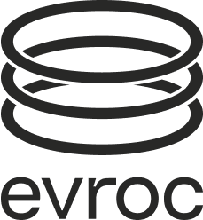

<div align="center">
  
</div>

[](https://opensource.org/licenses/Apache-2.0)

# evroc-skills

Agent skills for working with evroc cloud infrastructure. Each skill follows the [Agent Skills specification](https://agentskills.io/specification). These skills enable developers to create, modify, and delete resources and services on the [evroc](https://docs.evroc.com/).

This repository is packaged as a portable [Agent Plugin](https://agent-plugins.org/) (spec v1.0.0). The root `plugin.json` manifest declares the plugin identity; the `skills/` directory contains the skill components discovered by any Agent Plugins-compatible client. It also includes a [Cursor Plugin](https://cursor.com/docs/plugins) manifest (`.cursor-plugin/plugin.json`). The [Claude Plugin](https://claude.com/docs/plugins/build) lives in its own subfolder, [`claude-plugin/`](claude-plugin/) — see [Claude plugin](#claude-plugin) below.

> [!IMPORTANT]
> Large Language Models (LLMs) are probabilistic and may produce inaccurate, inappropriate, or unintended actions. Use caution when using these tools to create and delete resources. 

## Table of Contents
- [Skills Overview](#skills)
- [Repository Structure](#repository-structure)
- [Claude plugin](#claude-plugin)
- [Installation](#installation)
- [Usage](#usage)
- [License](#license)
- [Terms and Conditions](#terms-and-conditions)

## Skills

| Skill | Description |
| --- | --- |
| `evroc-rancher` | Deploy, inspect, and destroy Rancher Manager on evroc using Terraform |
| `evroc-networking` | Create, manage, and delete public IPs, security groups, subnets, and VPCs on evroc cloud |
| `evroc-compute` | Manage evroc compute resources: VMs, disks, snapshots, custom disk images, and placement groups via the evroc CLI |
| `evroc-storage` | Manage evroc storage: S3-compatible buckets, file stores, bucket service accounts, and KMS keys |
| `evroc-loadbalancer` | Manage evroc load balancers: backend pools, services, health checks, L4 routes, and listeners |
| `evroc-iam` | Manage evroc IAM: projects, role bindings, service accounts, credentials, and organization users and invitations |
| `evroc-think` | Manage evroc Think Models: dedicated instances, shared models, API keys, and coding agent integration |

Each skill includes:

- **Routing-optimized `description`** — clear "Use when... Do NOT use for..." triggers for agent routing
- **Verifiable completion criteria** — exact commands to confirm success
- **Quota failure mode** — every resource skill detects 403 `InsufficientQuota` errors,
  shows real quota usage via `evroc quotas orgquotas get`, and directs the user to
  support@evroc.com for quota increases
- **`references/`** — CLI flag references and domain-specific guides.
- **`scripts/`** — deterministic helper scripts for fragile operations and auth checks. 

## Repository Structure

```
evroc-skills/
├── plugin.json                    # Agent Plugin manifest (agent-plugins.org)
├── .cursor-plugin/plugin.json     # Cursor Plugin manifest
├── README.md
├── claude-plugin/                 # Claude Plugin (Markdown-only, submitted to the directory)
│   └── .claude-plugin/plugin.json
└── skills/
    ├── evroc-compute/
    │   ├── SKILL.md
    │   ├── scripts/
    │   │   ├── check-auth.sh
    │   │   └── check-quota.sh
    │   └── references/
    │       └── cli-reference.md
    ├── evroc-iam/
    │   ├── SKILL.md
    │   ├── scripts/
    │   │   └── check-auth.sh
    │   └── references/
    │       └── cli-reference.md
    ├── evroc-loadbalancer/
    │   ├── SKILL.md
    │   ├── scripts/
    │   │   ├── check-auth.sh
    │   │   └── check-quota.sh
    │   └── references/
    │       └── cli-reference.md
    ├── evroc-rancher/
    │   ├── SKILL.md
    │   ├── scripts/
    │   │   ├── prerequisites.sh
    │   │   ├── deploy.sh
    │   │   ├── destroy.sh
    │   │   ├── status.sh
    │   │   └── check-public-ip-quota.sh
    │   ├── assets/
    │   │   ├── .terraform.lock.hcl
    │   │   ├── main.tf
    │   │   ├── variables.tf
    │   │   ├── terraform.tfvars.example
    │   │   ├── cloud-init-rancher.yaml
    │   │   └── cloud-init-workload.yaml
    │   └── references/
    │       └── troubleshooting.md
    ├── evroc-storage/
    │   ├── SKILL.md
    │   ├── scripts/
    │   │   ├── check-auth.sh
    │   │   └── check-quota.sh
    │   └── references/
    │       └── cli-reference.md
    ├── evroc-think/
    │   ├── SKILL.md
    │   ├── scripts/
    │   │   ├── check-auth.sh
    │   │   └── check-quota.sh
    │   ├── references/
    │   │   ├── cli-reference.md
    │   │   └── dedicated-instances.md
    └── evroc-networking/
        ├── SKILL.md
        ├── scripts/
        │   ├── check-auth.sh
        │   ├── check-quota.sh
        │   └── check-public-ip-quota.sh
        └── references/
            └── cli-reference.md
```


## Claude plugin

[`claude-plugin/`](claude-plugin/) is the repository's **only** Claude plugin —
its manifest is `claude-plugin/.claude-plugin/plugin.json`. It holds a
Markdown-only copy of six skills, packaged for Anthropic's plugin directory.

The directory accepts only Markdown, text, JSON, YAML, and images from
unverified organizations and scans every file under the plugin root, so the
plugin lives in a subfolder rather than at the repository root: it carries no
`scripts/` or `assets/` — the preflight checks and quota lookups are written out
as CLI commands in the skill instructions instead — and it omits
`evroc-rancher`, whose Terraform module cannot ship under those rules.

To submit or validate it, give `claude-plugin` as the plugin path:

```
claude plugin validate ./claude-plugin
```

`skills/` remains the source of truth and is what `npx skills add` and Cursor
use. Changes belong there first; port them into `claude-plugin/` when they
affect the six skills it ships.

## Installation

To install the skills, run the below command:

```
npx skills add evroc-oss/evroc-skills
```

## Usage

Skills are automatically available once installed. The agent will use them when
relevant tasks are detected.

**Examples:**

```
Create a VM with 50GB boot disk and nginx pre-installed
```

```
List all my running VMs and show their public IPs
```

```
Create a security group allowing SSH and HTTP, then attach it to my-vm
```

```
Set up a Think Model instance and give me an API key for it
```

## License

Apache-2.0

## Terms and Conditions 

All code here is covered by the [Terms and Conditions](https://evroc.com/legal/general-terms-and-conditions/) of evroc.
